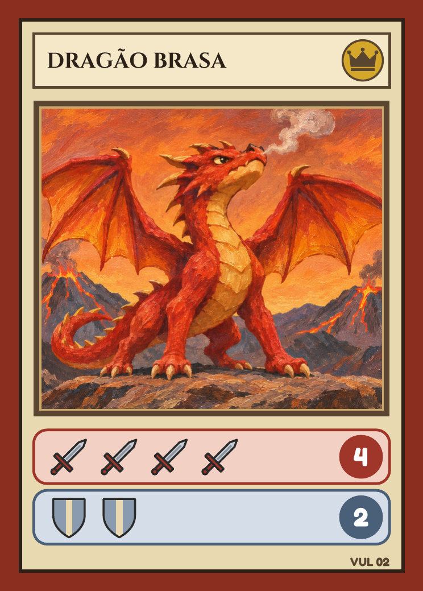

# Arena dos Monstros

Jogo de cartas de monstros para imprimir em casa e jogar com crianças pequenas, a partir de uns 4 anos. Não precisa ler: cada monstro mostra ataque e defesa em ícones para contar, e as vidas são fichas físicas. A ideia é ensinar os conceitos básicos de um TCG (monte, mão, campo, descarte, vida, atacar, deitar a carta) sem efeitos, magias ou armadilhas.

**Este projeto é feito com inteligência artificial (IA).** O jogo nasceu da ideia de um pai de jogar cartas com o filho de 4 anos. As ilustrações e a moldura foram geradas com IA. Ela também ajudou a desenvolver as regras e o código que monta o PDF para impressão.



## Conteúdo do repositório

| Caminho | O que tem |
|---|---|
| `README.md` | Regras do jogo e instruções de impressão. |
| `ESPECIFICACAO.md` | Layout da carta, cores, ícones, direção de arte e prompts para gerar as artes. |
| `decks/vulcao/` | Deck Vulcão: lista de monstros (`cartas.json`), descrição das artes e pasta `arte/`. |
| `decks/mar/` | Deck Mar: lista de monstros (`cartas.json`), descrição das artes e pasta `arte/`. |
| `impressao/arena-dos-monstros.pdf` | PDF pronto para imprimir em A4 (40 cartas e fichas de vida). |
| `ferramentas/gerar_pdf.py` | Script que monta o PDF a partir dos decks e das artes. |

---

## Material

- 2 decks de 20 cartas (Vulcão e Mar).
- 5 fichas de vida por jogador (tampinhas ou as fichas da última página do PDF).

## Conceitos

| Termo | O que é |
|---|---|
| **Monte** | Pilha de cartas virada para baixo. É de onde você compra. |
| **Mão** | Cartas que você segura. |
| **Campo** | Até 3 espaços na sua frente onde ficam os seus monstros. |
| **Descarte** | Pilha virada para cima para onde vão os monstros derrotados. |
| **Vida** | As fichas. Se acabarem, você perde. |
| **Ataque ⚔️** | Quantidade de espadas na carta. É a força para bater. |
| **Defesa 🛡️** | Quantidade de escudos na carta. É a força para aguentar. |
| **Em pé** | Carta na vertical. O monstro pode atacar. |
| **Deitado** | Carta virada de lado. O monstro já atacou neste turno. |
| **Coroa** | Selo dourado dos monstros fortes (4 ou 5 ⚔️). Só faz diferença a partir do Nível 3. |

## Mesa

```
                (oponente)
 [DESCARTE] [MONTE]   [CAMPO 3] [CAMPO 2] [CAMPO 1]   [VIDAS]


 [VIDAS]   [CAMPO 1] [CAMPO 2] [CAMPO 3]   [MONTE] [DESCARTE]
                  (você)
```

---

## Regras (Nível 1)

Você ganha assim que o outro jogador perde a última ficha de vida.

### Preparação

1. Cada jogador pega um deck e embaralha.
2. Cada jogador coloca 5 fichas de vida ao lado.
3. Cada jogador compra 3 cartas.
4. O mais novo começa.

### Turno

O turno tem sempre a mesma ordem:

1. **Levantar:** coloque em pé todos os seus monstros que estiverem deitados.
2. **Comprar:** compre 1 carta do monte.
3. **Baixar:** você pode colocar 1 monstro da mão em um espaço vazio do seu campo, em pé. Se o campo estiver cheio (3 monstros), não dá para baixar.
4. **Atacar:** escolha um dos seus monstros em pé, deite a carta e resolva o ataque. Depois você pode atacar com outro monstro em pé ou passar a vez. Você também pode passar sem atacar.
5. **Passar a vez.**

Quem começa o jogo não ataca no primeiro turno.

### Combate

**Se o oponente tem monstros no campo**, quem ataca escolhe um deles como alvo. Pode escolher até um monstro deitado, que defende com todos os seus escudos. Conte as ⚔️ do atacante e os 🛡️ do alvo.

| Contagem | O que acontece |
|---|---|
| Mais ⚔️ que 🛡️ | O monstro atacado vai para o descarte. |
| Mesma quantidade | Os dois monstros vão para o descarte, cada um na pilha do seu dono. |
| Menos ⚔️ que 🛡️ | Os dois ficam no campo. |

O atacante que fica no campo continua deitado. O monstro que defendeu e ficou no campo mantém a posição em que estava.

**Se o campo do oponente está vazio**, o ataque é direto. O oponente perde **1 ficha de vida**, qualquer que seja a quantidade de espadas do atacante.

Por exemplo, se o Lagarto Faísca (5 ⚔️) atacar o Golem Geleira (5 🛡️), os dois vão para o descarte. Se o Golem era o último monstro do oponente, outro monstro seu que ainda esteja em pé já pode atacar direto nesse turno.

### Fim de jogo

- Assim que um jogador perde a última ficha de vida, o outro vence.
- Se alguém precisar comprar e o monte estiver vazio, a partida termina. Contem as fichas de vida. Quem tiver mais vence. Se os dois tiverem a mesma quantidade, a partida termina empatada.

---

## Regras para ir subindo

Só acrescente quando a criança já estiver fazendo as fases do turno sozinha.

### Nível 2

- **Cansaço:** o monstro que acabou de ser baixado entra deitado e só ataca no próximo turno.
- **Ataque com risco:** se as ⚔️ do atacante forem menores que os 🛡️ do alvo, o atacante é que vai para o descarte.
- **Abrir espaço:** com o campo cheio, você pode mandar um monstro seu do campo para o descarte antes de baixar outro.

### Nível 3

- **Sacrifício:** para baixar um monstro com coroa, você precisa mandar 1 monstro seu do campo para o descarte. Se não tiver nenhum monstro no campo, não dá para baixar monstro com coroa. É a primeira noção de custo, e evita que o jogo vire "baixar sempre o mais forte".

### Variações

- **Partida curta:** 3 fichas de vida para cada um.
- **Montar deck:** quando existirem mais monstros, cada jogador escolhe as próprias 20 cartas, com no máximo 2 cópias de cada.

### Ponte para TCGs de verdade (para o adulto)

| Aqui | No One Piece Card Game |
|---|---|
| Monte, mão, descarte | Deck, mão, trash |
| Deitar depois de atacar | Descansar a carta (rest) |
| Ataque direto | Atacar o líder |
| Fichas de vida | Cartas de vida |
| Coroa e sacrifício | Custo pago com DON!! |

### Ideia para uma fase futura

O bloqueio opcional fica para um teste futuro. A ideia é permitir que quem defende deite um monstro em pé para proteger uma vida. Nos níveis 1 a 3, quem ataca continua escolhendo o alvo pelas regras de combate acima.

---

## Dicas para as primeiras partidas

- Joguem de mão aberta no começo, para o adulto poder ajudar nas escolhas.
- Falem as fases em voz alta: "levanta, compra, baixa, ataca".
- Contem os ícones com o dedo.
- Dá para comparar colocando uma carta ao lado da outra: os ícones têm sempre o mesmo tamanho e espaçamento, então a fileira mais comprida é a maior.

## Composição dos decks

Cada deck tem 10 monstros diferentes, com 2 cópias de cada (20 cartas). A soma de ⚔️ e 🛡️ é sempre 6.

| Perfil | ⚔️ | 🛡️ | Coroa | Cartas no deck |
|---|---|---|---|---|
| Atacante puro | 5 | 1 | Sim | 2 |
| Atacante | 4 | 2 | Sim | 4 |
| Equilibrado | 3 | 3 | Não | 8 |
| Defensor | 2 | 4 | Não | 4 |
| Muralha | 1 | 5 | Não | 2 |

As listas de monstros estão em [`decks/vulcao`](decks/vulcao) e [`decks/mar`](decks/mar).

---

## Impressão e montagem

- Imprima `impressao/arena-dos-monstros.pdf` em A4, em **100% (tamanho real)**. Desligue "ajustar à página".
- Antes de imprimir tudo, imprima uma folha e compare uma carta com uma carta de Magic ou One Piece. As duas têm 63 x 88 mm.
- Papel: sulfite de 75 a 90 g/m² ou couchê fosco de 90 a 120 g/m² (cores melhores e sem reflexo).
- Corte pelas marcas cinza. As cartas ficam encostadas, então cada corte separa duas cartas.
- Monte em sleeve padrão (66 x 91 mm) com o papel impresso na frente e uma carta comum de qualquer TCG atrás, para dar firmeza. Sleeves com verso opaco deixam todas iguais por trás.
- Sleeves de cores diferentes para cada deck ajudam a separar na hora de guardar.
- A última página tem as fichas de vida. Recorte pela borda colorida.

## Como adicionar as artes e gerar o PDF

Gere as artes seguindo a [especificação](ESPECIFICACAO.md). Se receber só a ilustração, uma imagem quadrada de 1024 x 1024 serve. Salve na pasta `arte/` do deck com o nome do `cartas.json`, como `decks/vulcao/arte/VUL-02-dragao-brasa.png`.

Se o gerador devolver a carta inteira (1061 x 1482 px ou a mesma proporção), use o código da carta para recortar a janela e salvar a arte na pasta certa. Com o ambiente virtual abaixo ativado, rode `python3 ferramentas/extrair_arte.py carta.png "VUL 02"`. Com uv, rode `uv run --no-project --with pillow python3 ferramentas/extrair_arte.py carta.png "VUL 02"`. Para substituir uma arte existente, acrescente `--forcar`.

Para gerar o PDF com **uv**, rode na raiz do repositório:

```sh
uv run --no-project --with reportlab --with pillow python3 ferramentas/gerar_pdf.py
```

Se preferir usar **ambiente virtual e pip**, rode:

```sh
python3 -m venv .venv
source .venv/bin/activate
python3 -m pip install -r requirements.txt
python3 ferramentas/gerar_pdf.py
```

O script enquadra a arte na janela chanfrada, confere se ataque + defesa = 6 e se cada deck tem 20 cartas, e lista as artes que ainda faltam. Cartas sem arte saem com o aviso "ARTE PENDENTE".

Fontes usadas: [Cinzel](https://fonts.google.com/specimen/Cinzel) e [Fredoka](https://fonts.google.com/specimen/Fredoka), ambas sob a SIL Open Font License (licenças em `ferramentas/fontes/`).

## Como contribuir

Jogou uma partida e alguma regra deixou dúvida? Conte quais cartas estavam na mesa, o que aconteceu e como vocês resolveram. Sugestões de monstros e relatos de problemas de impressão também são bem-vindos. Se o problema for com uma carta, inclua o código que aparece no rodapé, como `VUL 02`. [Abrir uma issue no GitHub](https://github.com/glaucomorandini/arena-dos-monstros-tcg/issues/new)

### Como enviar um pull request (PR)

1. Faça um [fork do repositório](https://github.com/glaucomorandini/arena-dos-monstros-tcg/fork) para criar uma cópia na sua conta do GitHub.
2. Clone o seu fork e crie uma branch para a mudança. Troque `SEU-USUARIO` pelo seu nome no GitHub.

   ```sh
   git clone https://github.com/SEU-USUARIO/arena-dos-monstros-tcg.git
   cd arena-dos-monstros-tcg
   git switch -c minha-contribuicao
   ```

3. Faça a alteração. Para regras, edite este README. Para mudar uma carta, consulte a [especificação](ESPECIFICACAO.md) e o `cartas.json` do deck. Se a mudança afetar a impressão, gere o PDF seguindo as instruções acima, confira a carta na página e inclua o PDF atualizado no PR.
4. Confira os arquivos com `git status`, adicione os que fazem parte da mudança com `git add` e envie a branch. Para uma correção no README, por exemplo:

   ```sh
   git add README.md
   git commit -m "Esclarece a regra de combate"
   git push -u origin minha-contribuicao
   ```

5. No GitHub, abra um pull request da branch `minha-contribuicao` do seu fork para a `main` de `glaucomorandini/arena-dos-monstros-tcg`. Conte o que mudou e por quê. Um exemplo de jogada ajuda a revisar uma regra, e uma imagem da carta ajuda a revisar uma mudança visual. [Abrir um pull request](https://github.com/glaucomorandini/arena-dos-monstros-tcg/compare)
